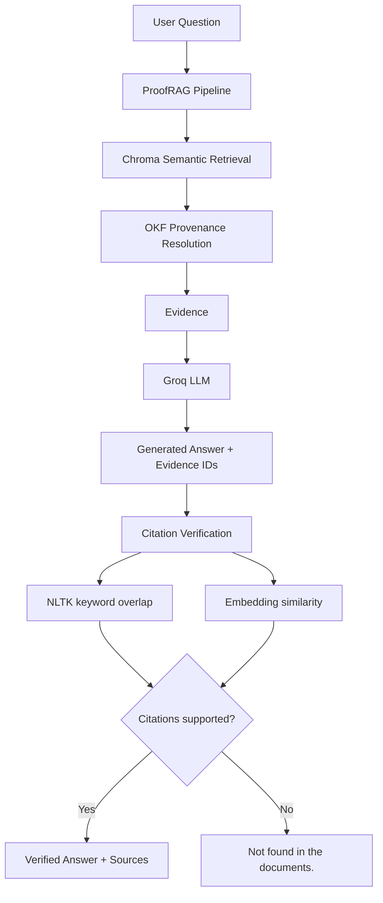
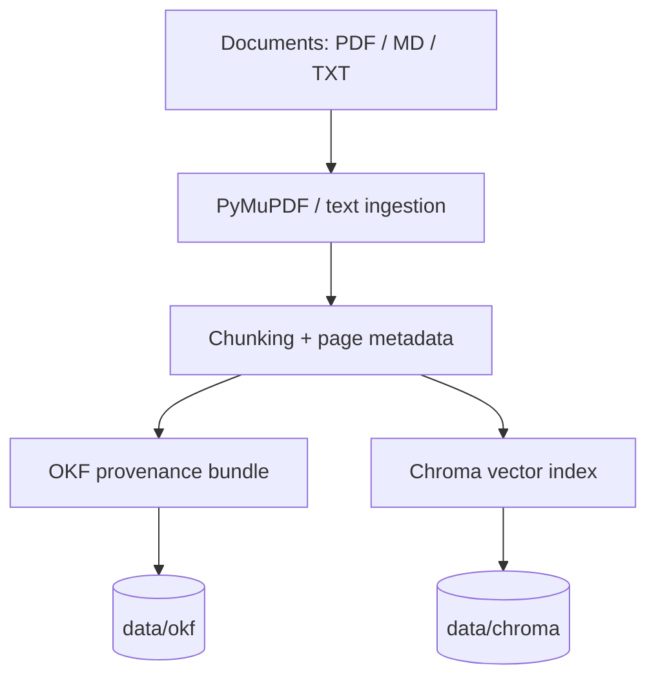

# ProofRAG — Answer with Proof

> **RAG that proves its answers or refuses to answer.**

[](https://pypi.org/project/proofrag-ai/)
[](https://www.python.org/)
[](https://github.com/astral-sh/ruff)
[](https://docs.pytest.org/)
[](LICENSE)

ProofRAG is an evidence-backed Retrieval-Augmented Generation (RAG) library, REST API and CLI. Every answer it returns is tied to specific source documents, pages and text snippets, and **every citation is verified after generation**. If the documents do not contain enough evidence, ProofRAG does not guess. It returns:

```
Not found in the documents.
```

---

## Table of Contents

- [Why ProofRAG](#why-proofrag)
- [How It Works](#how-it-works)
- [Features](#features)
- [Tech Stack](#tech-stack)
- [Project Structure](#project-structure)
- [Installation](#installation)
- [Configuration](#configuration)
- [Quick Start](#quick-start)
- [Python API](#python-api)
- [REST API](#rest-api)
- [CLI](#cli)
- [Citation Verification](#citation-verification)
- [Testing and Linting](#testing-and-linting)
- [Design Decisions](#design-decisions)
- [Limitations](#limitations)
- [Roadmap](#roadmap)
- [Contributing](#contributing)
- [License](#license)

---

## Why ProofRAG

A conventional RAG chatbot retrieves documents and then generates an answer. Nothing guarantees that the answer is actually *supported* by what was retrieved. The model can blend retrieved text with prior knowledge, misattribute a claim, or answer confidently when retrieval returned irrelevant chunks.

ProofRAG treats the LLM as an **untrusted component**:

1. The model must cite the evidence IDs it used.
2. A separate verification stage checks each citation against the cited evidence.
3. Answers that fail verification, or questions with no sufficient evidence, produce a refusal instead of a hallucination.

The result is a system where a user can inspect *why* an answer was given, and where "I don't know" is a first-class, reliable outcome.

---

## How It Works

ProofRAG is a hybrid of **OKF + RAG + Citation Verification**.

- **Chroma** provides semantic vector retrieval.
- **Open Knowledge Format (OKF)** provides structured knowledge and provenance (document, page, chunk, text).
- **OKF does not replace Chroma.** Chroma finds candidate chunks; OKF resolves each one into verifiable provenance.

### Query path



### Ingestion path



---

## Features

1. **Evidence-backed answers.** Answers are generated only from retrieved evidence.
2. **Source filename and page information.** Every piece of evidence carries its origin file and page.
3. **Exact supporting snippets.** The returned evidence is the actual text the answer relies on.
4. **Structured provenance.** Documents, chunks and pages are recorded in OKF bundles.
5. **Semantic retrieval.** Chroma with `sentence-transformers/all-MiniLM-L6-v2` embeddings.
6. **Citation verification.** Every citation the LLM emits is checked after generation.
7. **Keyword overlap verification.** NLTK-based lexical grounding of claims in cited evidence.
8. **Embedding similarity verification.** Semantic grounding check between answer and cited evidence.
9. **Safe refusal.** Insufficient or unsupported evidence yields `Not found in the documents.`
10. **Deterministic identifiers.** Document and chunk IDs are stable across re-ingestion.
11. **PDF / Markdown / TXT ingestion.** PDFs are parsed with PyMuPDF with page-level metadata.
12. **Persistent Chroma storage.** The index survives restarts.
13. **FastAPI REST API.** Typed endpoints with auto-generated OpenAPI docs.
14. **CLI.** Ingest and query from the terminal (Typer).
15. **Pydantic contracts.** Validated request and response models.
16. **Configurable thresholds.** Retrieval and verification thresholds via YAML and `.env`.
17. **Automated tests.** pytest suite covering every module.
18. **LLM provider abstraction.** The generator is isolated, so providers can be swapped.
19. **Safe failure handling.** Provider errors, empty retrieval and malformed LLM output degrade to a refusal or a clear error rather than an unverified answer.

---

## Tech Stack

| Area | Technology |
|---|---|
| Language | Python 3.11 |
| API | FastAPI |
| CLI | Typer |
| Data models | Pydantic |
| Orchestration | LangChain |
| Vector store | Chroma |
| Embeddings | Hugging Face `sentence-transformers/all-MiniLM-L6-v2` |
| LLM | Groq API, `openai/gpt-oss-120b` |
| PDF parsing | PyMuPDF |
| Text processing | NLTK |
| Provenance | Open Knowledge Format (OKF) |
| Testing / linting | pytest, Ruff |

> **Note:** the default LLM is `openai/gpt-oss-120b`, which replaced the retired `llama-3.3-70b-versatile` on Groq.

---

## Project Structure

```
ProofRAG/
├── .env.example
├── .gitignore
├── app.py                  # ASGI entry point for the API server
├── LICENSE
├── pyproject.toml
├── README.md
├── data/
│   ├── chroma/             # Persistent Chroma vector index
│   ├── documents/          # Source documents to ingest
│   └── okf/                # OKF provenance bundles
├── examples/
│   ├── basic_usage.py
│   ├── sample_query.py
│   └── e2e_demo.py
├── src/
│   └── proofrag/
│       ├── __init__.py
│       ├── api.py
│       ├── cli.py
│       ├── config.py
│       ├── embeddings.py
│       ├── generator.py
│       ├── ingestion.py
│       ├── models.py
│       ├── okf.py
│       ├── pipeline.py
│       ├── retrieval.py
│       └── verifier.py
└── tests/
    ├── __init__.py
    ├── test_api.py
    ├── test_generator.py
    ├── test_ingestion.py
    ├── test_models.py
    ├── test_okf.py
    ├── test_pipeline.py
    ├── test_retrieval.py
    └── test_verifier.py
```

### Module guide

| Module | Responsibility |
|---|---|
| `pipeline.py` | Orchestrates the full flow: retrieve, resolve provenance, generate, verify, answer or refuse. The main entry point for library users. |
| `ingestion.py` | Reads PDF / Markdown / TXT, extracts page-aware text, chunks it, assigns deterministic IDs, and writes to OKF and Chroma. |
| `okf.py` | Reads and writes Open Knowledge Format bundles and resolves a chunk ID to its full provenance. |
| `retrieval.py` | Semantic search over Chroma and mapping of hits to OKF-backed evidence. |
| `embeddings.py` | Loads and wraps the Hugging Face embedding model used for retrieval and verification. |
| `generator.py` | LLM abstraction. Builds the prompt, calls Groq, and parses the answer and cited evidence IDs. |
| `verifier.py` | Post-generation citation verification via NLTK keyword overlap and embedding similarity. |
| `models.py` | Pydantic models for evidence, citations, requests and responses. |
| `config.py` | Settings from YAML and environment variables, including thresholds. |
| `api.py` | FastAPI application and routes. |
| `cli.py` | Typer command-line interface. |

---

## Installation

### From PyPI

```bash
pip install proofrag-ai
```

The distribution name on PyPI is **`proofrag-ai`**. The Python import name is **`proofrag`**:

```python
import proofrag
```

### From source (Windows PowerShell)

```powershell
cd D:\ProofRAG
python -m venv .proofrag
.\.proofrag\Scripts\Activate.ps1
pip install -e ".[dev]"
```

If PowerShell blocks script activation, run this once for your user:

```powershell
Set-ExecutionPolicy -Scope CurrentUser RemoteSigned
```

### From source (macOS / Linux)

```bash
git clone <your-repo-url> ProofRAG
cd ProofRAG
python3.11 -m venv .proofrag
source .proofrag/bin/activate
pip install -e ".[dev]"
```

### NLTK data

The keyword-overlap verifier uses NLTK resources. If they are not downloaded automatically on first run:

```powershell
python -c "import nltk; nltk.download('punkt'); nltk.download('stopwords')"
```

---

## Configuration

Copy the example environment file and add your Groq key:

```powershell
Copy-Item .env.example .env
```

```env
GROQ_API_KEY=your_groq_api_key_here
```

Get a key from the [Groq Console](https://console.groq.com/). **Never commit `.env`.** It is already listed in `.gitignore`.

Defaults:

| Setting | Default |
|---|---|
| LLM model | `openai/gpt-oss-120b` |
| Embedding model | `sentence-transformers/all-MiniLM-L6-v2` |
| Chroma directory | `data/chroma` |
| OKF directory | `data/okf` |
| Documents directory | `data/documents` |

Retrieval size and verification thresholds (keyword overlap, embedding similarity) are configurable through YAML configuration and environment variables. See `src/proofrag/config.py` for the full list.

---

## Quick Start

1. Put documents in `data/documents/` (PDF, `.md` or `.txt`).
2. Ingest them.
3. Ask a question.

```powershell
proofrag ingest data/documents
proofrag ask "What is the refund policy?"
```

Or run the end-to-end demo:

```powershell
python examples/e2e_demo.py
```

---

## Python API

```python
from proofrag import ProofRAG

rag = ProofRAG()
rag.ingest("data/documents")

result = rag.ask("What is the refund policy?")

print(result.answer)
for ev in result.evidence:
    print(ev.source, ev.page, ev.text)
```

A supported answer returns the answer text plus its verified evidence (source file, page, supporting snippet). An unsupported question returns:

```
Not found in the documents.
```

See `examples/basic_usage.py` and `examples/sample_query.py` for runnable versions.

---

## REST API

Start the server:

```powershell
uvicorn app:app --reload
```

Interactive OpenAPI docs are served at `http://127.0.0.1:8000/docs`.

Example request:

```bash
curl -X POST http://127.0.0.1:8000/ask \
  -H "Content-Type: application/json" \
  -d '{"question": "What is the refund policy?"}'
```

Request and response bodies are validated by the Pydantic models in `models.py`, and the schemas are visible in the OpenAPI docs.

---

## CLI

```powershell
proofrag --help
proofrag ingest <path>
proofrag ask "<question>"
```

Run `proofrag --help` for the complete, current command list.

---

## Citation Verification

After the LLM answers, ProofRAG does not trust its citations. Each cited evidence ID goes through two independent checks:

| Check | What it catches |
|---|---|
| **Keyword overlap (NLTK)** | Answers whose key terms do not appear in the cited evidence. |
| **Embedding similarity** | Answers that are lexically different from the evidence but semantically unsupported. |

A citation must satisfy the configured thresholds to be accepted. If citations are missing, refer to evidence that was never retrieved, or fail verification, the pipeline refuses with `Not found in the documents.`

Verification is deliberately a separate module (`verifier.py`) so that the thresholds can be tuned and tested independently of generation.

---

## Testing and Linting

```powershell
pytest
ruff check .
```

The test suite covers the API, generator, ingestion, models, OKF handling, pipeline, retrieval and verifier. Tests for the generator and pipeline should not need a live Groq call.

---

## Design Decisions

- **The LLM is untrusted.** Trust is established by verification, not by prompting alone.
- **Refusal is a feature.** A wrong confident answer is worse than "Not found in the documents."
- **OKF alongside Chroma.** Vector search is good at finding relevant text but poor at provenance. OKF keeps the document, page and chunk lineage explicit and inspectable.
- **Deterministic IDs.** Re-ingesting the same document produces the same IDs, so citations are stable and the index does not accumulate duplicates.
- **Provider abstraction.** `generator.py` isolates the LLM so a different provider can be added without touching retrieval or verification.

---

## Limitations

- Verification is heuristic (lexical plus embedding similarity). It significantly reduces unsupported answers but is not a formal proof of entailment.
- Quality depends on chunking and on the embedding model. `all-MiniLM-L6-v2` is small and fast but not state of the art.
- Scanned PDFs without a text layer require OCR, which is not included.
- The default LLM requires a Groq API key and network access.

---

## Roadmap

- NLI / entailment-based verification as an additional check
- Additional LLM providers
- Hybrid (BM25 + vector) retrieval
- OCR support for scanned PDFs
- Evaluation harness with groundedness metrics

---

## Contributing

Contributions are welcome.

```powershell
pip install -e ".[dev]"
pytest
ruff check .
```

Please open an issue to discuss significant changes before submitting a pull request.

---

## License

See [LICENSE](LICENSE).